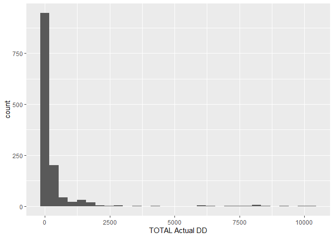
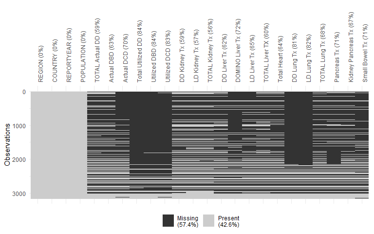
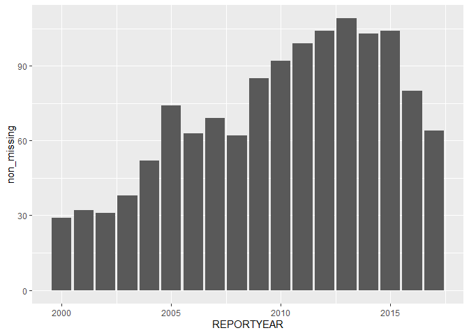
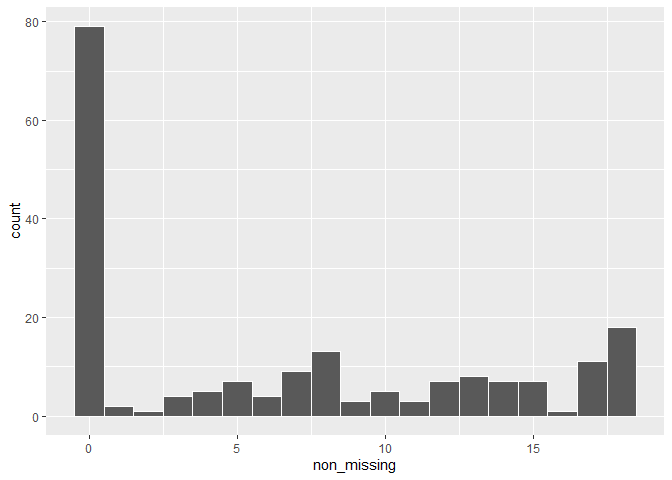
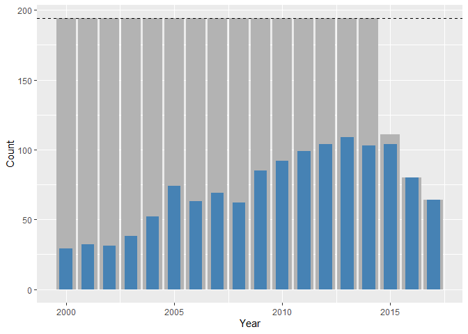

# \[Chapter 4\] Cleaning the global organ donation trends data


## Domain problem formulation

Our goal for this project is to understand global organ donation trends,
in particular, we want to identify countries that have demonstrated an
increase in organ transplant donation rates over time, and which
countries have the highest organ donation rates.

## Data source overview

In this file, we will examine and clean the organ donation data which
comes from the publicly available survey data from the Global
Observatory on Donation and Transplantation (GODT) that was collected in
a collaboration between World Health Organization (WHO) and the Spanish
Transplant Organization, Organización Nacional de Trasplantes (ONT). The
data portal can be found at
http://www.transplant-observatory.org/export-database/.

This database contains information about organ donations and transplants
(a total of 24 variables) for 194 countries and is collected every year
based on a survey that, according to the website, began in 2007. We will
consider a version of the data that contains information up to 2017
(downloaded in 2018) for this project.

First, let’s load the libraries that we will use in this document.

``` r
# load the libraries we will need in this document
library(tidyverse)
library(naniar) # this is a nice package for visualizing missing data
```

The data is contained within the file
`data/global-organ-donation_2018.csv`. The questionnaire on which the
data is based is contained within the
`data/documentation/Questionnaire.pdf` PDF file. If you plan on working
with this data, we highly recommend that you glance through this
document.

## Step 1: Review background information

For additional background information on this project and dataset and
the project, see the relevant PCS documentation for this project.

- *What does each variable measure?* A data dictionary is presented in
  the subsection below.

- *How was the data collected?* The website
  (<http://www.transplant-observatory.org/methodology/>) from which we
  downloaded the organ donation data states that the data is based on a
  survey that began in 2007, and is sent annually via email to “national
  focal points”. For countries that have a centralized organ donation
  and transplantation organization, this information would likely be
  much easier to obtain than for the countries that do not have
  well-organized transplant systems (or which have multiple donor
  organizations). A copy of the survey itself is provided in the
  “data/documentation” folder[^1]. Some questions that arise include:
  Who were these survey forms sent to (e.g., who is the contact point)?
  Which countries each country have a centralized organ donation
  organization? Some reading online revealed a very wide range of organ
  donation practices worldwide.

- *What are the observational units?* To identify the observational
  units, consider for what entities each full set of organ donation
  measurements is collected. For the organ donation data, these are the
  year and country combinations (a complete set of measurements are
  taken for each country, every year), which we will call the
  “country-years”.

- *Is the data relevant to my project?* Since this data is likely the
  most comprehensive public global summary of organ donations available,
  and since it covers a reasonably broad time period, this data is
  certainly relevant to the project.

- *What questions do I have and what assumptions am I making?* One
  immediate *assumption* that we made when looking at the data was that
  there exists a hierarchy for some of the variables. For instance, the
  total number of deceased donors (`TOTAL Actual DD`) appears to be
  broken down into brain-death deceased donors (`Actual DBD`) and
  circulatory-death deceased donors (`Actual DCD`), implying that these
  two sub-counts *should* add up to the total count. After we loaded the
  data into R (in the next step), we conducted some quick checks in the
  data to confirm that this is true in all but a small number of rare
  cases.

### Data dictionary

The data dictionary we found on the website at the time of data
collection is printed below:

``` rmarkdown
REGION: the global region in which the country lies
COUNTRY: the name of the country for which the data is collected
REPORTYEAR: the year for which the data is collected
POPULATION: the population of the country for the given year
TOTAL Actual DD: total number of deceased organ donors
Actual DBD: number of deceased organ donors after brain death
Actual DCD: number of deceased organ donors after circulatory death
Total Utilized DD: total number of utilized deceased organ donors
Utilized DBD: number of utilized deceased organ donors after brain death
Utilized DCD: number of utilized deceased organ donors after circulatory death
DD Kidney Tx: number of kidneys from deceased donors
LD Kidney Tx: number of kidneys from living donors
TOTAL Kidney Tx: total number of kidneys from all donors
DD Liver Tx: number of livers from deceased donors
DOMINO Liver Tx: number of domino livers
LD Liver Tx: number of livers from living donors
TOTAL Liver Tx: total number of livers from all donors
TOTAL Heart: total number of hearts from all donors
DD Lung Tx: number of lungs from deceased donors
LD Lung Tx: number of lungs from living donors
TOTAL Lung Tx: total number of lungs from all donors
Pancreas Tx: total number of pancreases from all donors
Kidney Pancreas Tx: total number of kidney-pancreases from all donors
Small Bowel Tx: total number of small bowels from all donors
```

Some questions that immediately arise include what does it mean for an
organ donor to be *“utilized”*? Does this imply that not all donated
organs are used? After much scouring GODT resources, we eventually found
this definition in the following pdf
(https://tts.org/images/GODT/2020-Global-report-para-web-1.pdf):

- “Actual deceased donor”: Deceased person from whom at least one organ
  has been recovered for the purpose of transplantation.

- “Utilized deceased donor”: An actual donor from whom at least one
  organ has been transplanted.

That is, an organ from an “actual deceased donor” has been recovered for
the purpose of transplantation, but may not actually end up being
transplanted (presumably due to logistical issues, such as not finding a
suitable recipient, spoilage, etc).

Our gut feeling is that we should use the `TOTAL Actual DD` variable,
rather than the `Total Utilized DD` variable, but it will be helpful to
identify how similar/different these two variables are:

<div class="blackbox">

<div class="center">

**Question: What proportion of deceased donors are “utilized” deceased
donors?**

</div>

Do most organs recovered for transplantation actually get transplanted?

</div>

We will answer this question in our explorations below.

Feel free to document here any additional questions or assumptions that
you made while looking at the website or the data dictionary above.

## Step 2: Loading in the data

Let’s load in the data. Note that we had some issues using `read_csv()`
without specifying the column types (`read_csv()` would assume incorrect
types for columns with a lot of leading missing values, and then would
mess up the formatting of the remaining non-missing values in these
columns because they did not fit the presumed type). For this reason, we
provided a `col_types` argument to `read_csv()`.

``` r
organs_original <- read_csv("./data/global-organ-donation_2018.csv", 
                            col_types = list(`Utilized DBD` = col_number(),
                                             `DD Lung Tx` = col_number(),
                                             `Total Utilized DD` = col_number(),
                                             `LD Lung Tx` = col_number())) 
```

Below, we print the data column names and notice that they match the
names presented in the data dictionary.

``` r
colnames(organs_original)
```

     [1] "REGION"             "COUNTRY"            "REPORTYEAR"        
     [4] "POPULATION"         "TOTAL Actual DD"    "Actual DBD"        
     [7] "Actual DCD"         "Total Utilized DD"  "Utilized DBD"      
    [10] "Utilized DCD"       "DD Kidney Tx"       "LD Kidney Tx"      
    [13] "TOTAL Kidney Tx"    "DD Liver Tx"        "DOMINO Liver Tx"   
    [16] "LD Liver Tx"        "TOTAL Liver TX"     "Total Heart"       
    [19] "DD Lung Tx"         "LD Lung Tx"         "TOTAL Lung Tx"     
    [22] "Pancreas Tx"        "Kidney Pancreas Tx" "Small Bowel Tx"    

Below, we have printed the first 20 rows of the dataset. Note that *all
of the values after the first 4 identifier columns are missing for these
first 20 rows*. We checked the data manually to make sure that this was
not a data loading error, and it does seem that the data has been loaded
in correctly.

``` r
head(organs_original, n = 20)
```

| REGION | COUNTRY | REPORTYEAR | POPULATION | TOTAL Actual DD | Actual DBD | Actual DCD | Total Utilized DD | Utilized DBD | Utilized DCD | DD Kidney Tx | LD Kidney Tx | TOTAL Kidney Tx | DD Liver Tx | DOMINO Liver Tx | LD Liver Tx | TOTAL Liver TX | Total Heart | DD Lung Tx | LD Lung Tx | TOTAL Lung Tx | Pancreas Tx | Kidney Pancreas Tx | Small Bowel Tx |
|:---|:---|---:|---:|---:|---:|---:|---:|---:|---:|---:|---:|---:|---:|---:|---:|---:|---:|---:|---:|---:|---:|---:|---:|
| Europe | Andorra | 2000 | 0.1 | NA | NA | NA | NA | NA | NA | NA | NA | NA | NA | NA | NA | NA | NA | NA | NA | NA | NA | NA | NA |
| Eastern Mediterranean | United Arab Emirates | 2000 | 2.4 | NA | NA | NA | NA | NA | NA | NA | NA | NA | NA | NA | NA | NA | NA | NA | NA | NA | NA | NA | NA |
| Eastern Mediterranean | Afghanistan | 2000 | 22.7 | NA | NA | NA | NA | NA | NA | NA | NA | NA | NA | NA | NA | NA | NA | NA | NA | NA | NA | NA | NA |
| America | Antigua and Barbuda | 2000 | 0.1 | NA | NA | NA | NA | NA | NA | NA | NA | NA | NA | NA | NA | NA | NA | NA | NA | NA | NA | NA | NA |
| Europe | Albania | 2000 | 3.1 | NA | NA | NA | NA | NA | NA | NA | NA | NA | NA | NA | NA | NA | NA | NA | NA | NA | NA | NA | NA |
| Europe | Armenia | 2000 | 3.5 | NA | NA | NA | NA | NA | NA | NA | NA | NA | NA | NA | NA | NA | NA | NA | NA | NA | NA | NA | NA |
| Africa | Angola | 2000 | 12.9 | NA | NA | NA | NA | NA | NA | NA | NA | NA | NA | NA | NA | NA | NA | NA | NA | NA | NA | NA | NA |
| America | Argentina | 2000 | 37.0 | NA | NA | NA | NA | NA | NA | NA | NA | NA | NA | NA | NA | NA | NA | NA | NA | NA | NA | NA | NA |
| Europe | Austria | 2000 | 8.2 | 194 | 194 | 0 | NA | NA | NA | 357 | 37 | 394 | 151 | NA | NA | 151 | 87 | NA | NA | 59 | 30 | 30 | 6 |
| Western Pacific | Australia | 2000 | 18.9 | 195 | 195 | NA | NA | NA | NA | 350 | 178 | 528 | 149 | NA | NA | 149 | 57 | NA | NA | 90 | 26 | 26 | NA |
| Europe | Azerbaijan | 2000 | 7.7 | NA | NA | NA | NA | NA | NA | NA | NA | NA | NA | NA | NA | NA | NA | NA | NA | NA | NA | NA | NA |
| Europe | Bosnia and Herzegovina | 2000 | 4.0 | NA | NA | NA | NA | NA | NA | NA | NA | NA | NA | NA | NA | NA | NA | NA | NA | NA | NA | NA | NA |
| America | Barbados | 2000 | 0.3 | NA | NA | NA | NA | NA | NA | NA | NA | NA | NA | NA | NA | NA | NA | NA | NA | NA | NA | NA | NA |
| South-East Asia | Bangladesh | 2000 | 129.2 | NA | NA | NA | NA | NA | NA | NA | NA | NA | NA | NA | NA | NA | NA | NA | NA | NA | NA | NA | NA |
| Europe | Belgium | 2000 | 10.2 | 256 | 256 | NA | NA | NA | NA | 448 | 9 | 457 | 136 | NA | NA | 136 | 90 | NA | NA | 37 | 32 | 32 | NA |
| Africa | Burkina Faso | 2000 | 11.9 | NA | NA | NA | NA | NA | NA | NA | NA | NA | NA | NA | NA | NA | NA | NA | NA | NA | NA | NA | NA |
| Europe | Bulgaria | 2000 | 8.2 | 26 | 26 | NA | NA | NA | NA | 52 | 30 | 82 | NA | NA | NA | NA | NA | NA | NA | NA | NA | NA | NA |
| Eastern Mediterranean | Bahrain | 2000 | 0.6 | NA | NA | NA | NA | NA | NA | NA | NA | NA | NA | NA | NA | NA | NA | NA | NA | NA | NA | NA | NA |
| Africa | Burundi | 2000 | 6.7 | NA | NA | NA | NA | NA | NA | NA | NA | NA | NA | NA | NA | NA | NA | NA | NA | NA | NA | NA | NA |
| Africa | Benin | 2000 | 6.1 | NA | NA | NA | NA | NA | NA | NA | NA | NA | NA | NA | NA | NA | NA | NA | NA | NA | NA | NA | NA |

We also print a *random* sample of 20 rows from the data below.

``` r
set.seed(45219)
organs_original |>
  sample_n(size = 20) 
```

| REGION | COUNTRY | REPORTYEAR | POPULATION | TOTAL Actual DD | Actual DBD | Actual DCD | Total Utilized DD | Utilized DBD | Utilized DCD | DD Kidney Tx | LD Kidney Tx | TOTAL Kidney Tx | DD Liver Tx | DOMINO Liver Tx | LD Liver Tx | TOTAL Liver TX | Total Heart | DD Lung Tx | LD Lung Tx | TOTAL Lung Tx | Pancreas Tx | Kidney Pancreas Tx | Small Bowel Tx |
|:---|:---|---:|---:|---:|---:|---:|---:|---:|---:|---:|---:|---:|---:|---:|---:|---:|---:|---:|---:|---:|---:|---:|---:|
| Europe | Sweden | 2003 | 8.9 | 114 | 114 | 0 | NA | NA | NA | 215 | 130 | 345 | 122 | 7 | 5 | 127 | 38 | NA | NA | 27 | 9 | 2 | NA |
| Europe | Belgium | 2006 | 10.4 | 282 | 249 | 33 | NA | NA | NA | 445 | 41 | 486 | 218 | 1 | 18 | 236 | 77 | NA | NA | 87 | 24 | 20 | 0 |
| Western Pacific | Mongolia | 2010 | 2.7 | 1 | 1 | 0 | NA | NA | NA | 2 | 8 | 10 | 0 | 0 | 0 | 0 | 0 | NA | NA | 0 | NA | 0 | 0 |
| Europe | Italy | 2015 | 59.8 | 1369 | 1361 | 8 | 1165 | 1159 | 6 | 1578 | 303 | 1881 | 1071 | 0 | 23 | 1094 | 245 | 112 | 0 | 112 | 50 | 31 | 1 |
| Eastern Mediterranean | Djibouti | 2011 | 0.9 | NA | NA | NA | NA | NA | NA | NA | NA | NA | NA | NA | NA | NA | NA | NA | NA | NA | NA | NA | NA |
| Europe | Kazakhstan | 2010 | 15.8 | NA | NA | NA | NA | NA | NA | NA | NA | NA | NA | NA | NA | NA | NA | NA | NA | NA | NA | NA | NA |
| Europe | Ireland | 2013 | 4.6 | 86 | 80 | 6 | 82 | 76 | 6 | 147 | 38 | 185 | 55 | 0 | 0 | 55 | 11 | 32 | 0 | 32 | 11 | 11 | 0 |
| Africa | South Africa | 2013 | 52.8 | 70 | 65 | 5 | 70 | 65 | 5 | 140 | 101 | 241 | 50 | NA | 9 | 59 | 25 | 7 | 0 | 7 | 9 | 6 | 0 |
| Europe | Russian Federation | 2006 | 142.5 | NA | NA | NA | NA | NA | NA | NA | NA | NA | NA | NA | NA | NA | NA | NA | NA | NA | NA | NA | NA |
| Europe | Bosnia and Herzegovina | 2007 | 3.9 | NA | NA | NA | NA | NA | NA | NA | NA | NA | NA | NA | NA | NA | NA | NA | NA | NA | NA | NA | NA |
| Western Pacific | Mongolia | 2005 | 2.6 | 0 | 0 | 0 | NA | NA | NA | 0 | 4 | 4 | 0 | NA | 0 | 0 | NA | NA | NA | NA | NA | NA | NA |
| America | Peru | 2004 | 27.6 | 29 | 29 | NA | NA | NA | NA | 46 | 26 | 72 | 7 | NA | NA | 7 | NA | NA | NA | NA | NA | NA | NA |
| Europe | Montenegro | 2010 | 0.6 | NA | NA | NA | NA | NA | NA | NA | NA | NA | NA | NA | NA | NA | NA | NA | NA | NA | NA | NA | NA |
| Europe | Austria | 2014 | 8.5 | 212 | 206 | 6 | 207 | 201 | 6 | 375 | 71 | 446 | 136 | 0 | 6 | 142 | 68 | 134 | 0 | 134 | 21 | 19 | 0 |
| America | Guyana | 2002 | 0.8 | NA | NA | NA | NA | NA | NA | NA | NA | NA | NA | NA | NA | NA | NA | NA | NA | NA | NA | NA | NA |
| Africa | South Africa | 2007 | 47.7 | 62 | NA | NA | NA | NA | NA | 124 | 85 | 209 | 36 | NA | NA | 36 | 26 | NA | NA | 7 | 10 | NA | NA |
| America | Colombia | 2004 | 44.9 | 258 | 258 | NA | NA | NA | NA | 384 | 82 | 466 | 125 | NA | 6 | 131 | 27 | NA | NA | NA | NA | NA | NA |
| Europe | Netherlands | 2015 | 16.9 | 284 | 128 | 156 | 265 | 126 | 139 | 470 | 514 | 984 | 148 | 0 | 3 | 151 | 54 | 78 | 0 | 78 | 25 | 22 | 0 |
| Western Pacific | Malaysia | 2007 | 26.2 | 25 | 15 | 10 | NA | NA | NA | 24 | 31 | 55 | 5 | NA | NA | 5 | 3 | NA | NA | NA | 0 | 0 | 0 |
| America | Saint Vincent and the Grenadines | 2008 | 0.1 | NA | NA | NA | NA | NA | NA | NA | NA | NA | NA | NA | NA | NA | NA | NA | NA | NA | NA | NA | NA |

Next, we check the dimension of the data.

``` r
dim(organs_original)
```

    [1] 3165   24

The above code shows that there are 3,165 rows. As a sanity check, this
number should probably be divisible by the number of countries in the
data. The number of countries in the data is:

``` r
organs_original |> 
  summarise(n_distinct(COUNTRY))
```

| n_distinct(COUNTRY) |
|--------------------:|
|                 194 |

But 3,165 is *not* divisible by 194:

``` r
3165 / 194
```

    [1] 16.31443

Moreover, if the survey started in 2007 and we have data up to the year
2017 (11 years total), then we should have $11 \times 194 = 2,134$ rows
in the data. Clearly, *something* is wrong. At this stage, we don’t know
what is wrong but will make a note to ensure that we figure out what is
going on. If by the end of the evaluations that we will conduct below,
we haven’t figured it out, then we will do some specific explorations to
try and understand why.

<div class="blackbox">

<div class="center">

**Question: Why does the number of rows in the data not match what we
expect?**

</div>

The number of rows in the data are not divisible by the number of
countries, which is a bit strange, since we would have assumed that each
country would have contributed the same number of rows to the data.

</div>

To determine the ways in which the data needs to be cleaned, we will
follow the suggestions provided in Chapter 5 of Veridical Data Science.

## Step 3: Examine the data and create action items

In this section, we will look at the data itself to try to identify any
invalid values, understand the missing values, and any abnormalities in
the data, following the workflow outlined in Chapter 5.

### Finding invalid values

Below, we print out the smallest (minimum) and largest (maximum), and
average values of each numeric column.

``` r
organs_original |> 
  # keep only numeric variables
  select(where(is.numeric)) |> 
  # for each column, compute a data frame with the min, mean, and max.
  map_df(function(.col) { data.frame(min = min(.col, na.rm = TRUE),
                                     mean = mean(.col, na.rm = TRUE),
                                     max = max(.col, na.rm = TRUE)) },
         .id = "variable")
```

| variable           |  min |         mean |     max |
|:-------------------|-----:|-------------:|--------:|
| REPORTYEAR         | 2000 | 2007.7102686 |  2017.0 |
| POPULATION         |    0 |   35.2372828 |  1393.8 |
| TOTAL Actual DD    |    0 |  310.7263566 | 10286.0 |
| Actual DBD         |    0 |  289.4758679 |  8403.0 |
| Actual DCD         |    0 |   38.8727842 |  3298.0 |
| Total Utilized DD  |    0 |  285.6991870 |  9706.0 |
| Utilized DBD       |    0 |  248.2276265 |  8075.0 |
| Utilized DCD       |    0 |   39.6361905 |  3243.0 |
| DD Kidney Tx       |    0 |  487.1070336 | 14827.0 |
| LD Kidney Tx       |    0 |  303.1408759 |  6647.0 |
| TOTAL Kidney Tx    |    0 |  752.2312634 | 20638.0 |
| DD Liver Tx        |    0 |  243.1364010 |  7715.0 |
| DOMINO Liver Tx    |    0 |    1.4474576 |    71.0 |
| LD Liver Tx        |    0 |   45.6954545 |  1200.0 |
| TOTAL Liver TX     |    0 |  277.0598563 |  8082.0 |
| Total Heart        |    0 |   78.0517998 |  3273.0 |
| DD Lung Tx         |    0 |   56.1216216 |  2478.0 |
| LD Lung Tx         |    0 |    0.2030981 |    20.0 |
| TOTAL Lung Tx      |    0 |   59.7207473 |  2478.0 |
| Pancreas Tx        |    0 |   41.0184582 |  1484.0 |
| Kidney Pancreas Tx |    0 |   29.8423552 |   924.0 |
| Small Bowel Tx     |    0 |    3.7208791 |   198.0 |

Note: this `map_df()` function above is looping through each column of
the data frame and for each column, it returns a 1-row data frame with a
min, mean, and max column. The output is these 1-row data frames stacked
together into a single data frame, and adds an ID column called
“variable” (by specifying the argument `.id = "variable"` does).

There don’t appear to be any negative count values, but the population
seems to be on a strange scale (why are there countries whose population
is 0, why is the largest population just 1393.8, and how can you have .8
of a person?).

The table below shows the average recorded population for a sample of 20
countries.

``` r
set.seed(45219)
organs_original |>
  # for each country
  group_by(COUNTRY) |>
  # compute the average population
  summarise(POPULATION = mean(POPULATION)) |>
  ungroup() |>
  sample_n(20) |>
  # arrange the rows alphabetically
  arrange(COUNTRY)
```

| COUNTRY                               |  POPULATION |
|:--------------------------------------|------------:|
| Albania                               |   3.1562500 |
| Australia                             |  21.5277778 |
| Bangladesh                            | 149.9066667 |
| Belize                                |   0.2733333 |
| Central African Republic              |   4.2000000 |
| Costa Rica                            |   4.5333333 |
| Democratic People’s Republic of Korea |  23.5400000 |
| Gabon                                 |   1.4400000 |
| Kiribati                              |   0.0933333 |
| Paraguay                              |   6.3222222 |
| Republic of Moldova                   |   3.9722222 |
| Saint Lucia                           |   0.2000000 |
| Saint Vincent and the Grenadines      |   0.1000000 |
| Sierra Leone                          |   5.5400000 |
| Singapore                             |   4.7235294 |
| South Africa                          |  48.6647059 |
| Suriname                              |   0.4466667 |
| Tajikistan                            |   6.9312500 |
| United States of America              | 307.2222222 |
| Vanuatu                               |   0.2200000 |

Since we know the population of Australia should be more like 21.5
million, rather than 21.5, this implies that the populations are on a
scale of millions. We manually checked that this is also true for a few
other countries.

So that the population variable is as transparent as possible, we will
note a cleaning action item to be included in our final cleaning
function.

<div class="blackbox">

<div class="center">

**Data cleaning action item: Multiply the population variable by 1
million**

</div>

Multiply the population variable by 1 million. We won’t worry about the
rounding error, but note that these population values are far from
exact.

</div>

Taking another look at the first 20 rows printed in the table above (in
the data loading section), we also notice that the year pre-dates 2007,
which was when the survey supposedly began.

<div class="blackbox">

<div class="center">

**Question: Why does the data contain years pre-2007**

</div>

The data contains information prior to 2007, which was when the data
collection survey supposedly began. Why is this the case? We couldn’t
find information online to answer this question, but perhaps this is due
to back-reporting (i.e. countries providing historical data), or perhaps
it is a mistake in the documentation.

</div>

<div class="blackbox">

<div class="center">

**Data cleaning action item: Add an option to remove the pre-2007 data**

</div>

We want to have an option in our cleaning function to remove the
pre-2007 data, but the default option will be to keep it.

</div>

To investigate if there are any strange values in the `TOTAL Actual DD`
variable, the figure below displays a histogram of the `TOTAL Actual DD`
variable.

``` r
organs_original |>
  ggplot() +
  geom_histogram(aes(x = `TOTAL Actual DD`))
```

    `stat_bin()` using `bins = 30`. Pick better value `binwidth`.

    Warning: Removed 1875 rows containing non-finite outside the scale range
    (`stat_bin()`).



The distribution is heavily skewed with a lot of 0s, but nothing looks
particularly unusual.

Before moving on, let’s conduct some sanity checks by ensuring that the
number of total donors does not exceed the population and is not
exceeded by any of the sub-counts. The code below counts the number of
times (rows in which) the total donor count exceeds the population and
the number of times the total donor count is exceeded by the relevant
sub-count. We would expect each of these sums to be equal to 0.

``` r
organs_original |>
  summarise(donor_vs_pop = sum(`TOTAL Actual DD` > POPULATION * 1000000,
                               na.rm = TRUE),
            donor_vs_dcd = sum(`TOTAL Actual DD` < `Actual DCD`,
                               na.rm = TRUE),
            donor_vs_dbd = sum(`TOTAL Actual DD` < `Actual DBD`,
                               na.rm = TRUE),
            donor_vs_utilized = sum(`TOTAL Actual DD` < `Total Utilized DD`,
                                    na.rm = TRUE),
            donor_vs_kidney = sum(`TOTAL Actual DD` < `TOTAL Kidney Tx`,
                                  na.rm = TRUE),
            donor_vs_liver = sum(`TOTAL Actual DD` < `TOTAL Liver TX`,
                                  na.rm = TRUE),
            donor_vs_heart = sum(`TOTAL Actual DD` < `Total Heart`,
                                  na.rm = TRUE))
```

| donor_vs_pop | donor_vs_dcd | donor_vs_dbd | donor_vs_utilized | donor_vs_kidney | donor_vs_liver | donor_vs_heart |
|---:|---:|---:|---:|---:|---:|---:|
| 0 | 0 | 0 | 0 | 1201 | 179 | 0 |

Interestingly, the number of kidney and liver transplant counts seem to
often exceed the total number of donors. But using our domain knowledge,
this is not actually surprising once we realize that a single donor can
provide *two* kidneys for transplant, and a single donated liver can be
split between two recipients.

Overall, the only unusual or inconsistent values that we found come from
the population variable and the pre-2007 values.

### \[problem-specific\] Checking COUNTRY and YEAR combinations are unique

It occurs to us to check that each country-year combination is unique
(i.e., there are no duplicated entries in the data). The table below
counts the number of times each country-year combination appears in the
data and shows the distinct counts. Since the only entry is 1, this
implies that each country-year combination only appears once in the
data, which is good.

``` r
organs_original |>
  # count the number of unique country-reportyear combinations
  count(COUNTRY, REPORTYEAR) |>
  # show just the distinct counts
  distinct(n)
```

|   n |
|----:|
|   1 |

### Examining missing values

From our tables and histograms above, it doesn’t look like there are any
extreme values (such as `999`) that are hiding missing values. To make
sure, we will plot a histogram of a few of the variables.

The table below shows the number and proportion of missing rows in each
column, arranged in order of least to most missingness.

``` r
organs_original |> 
  # for each column, count the number of entries that are equal to NA
  summarise(across(everything(), ~sum(is.na(.)))) |>
  # convert the result to a "long-form" data frame
  pivot_longer(everything(), names_to = "variable", values_to = "missing_rows") |>
  # add a column corresponding to the *proportion* of missing values
  mutate(prop_missing = missing_rows / nrow(organs_original)) |>
  # arrange the rows in increasing order of missingness
  arrange(missing_rows)
```

| variable           | missing_rows | prop_missing |
|:-------------------|-------------:|-------------:|
| REGION             |            0 |    0.0000000 |
| COUNTRY            |            0 |    0.0000000 |
| REPORTYEAR         |            0 |    0.0000000 |
| POPULATION         |            0 |    0.0000000 |
| TOTAL Kidney Tx    |         1764 |    0.5573460 |
| LD Kidney Tx       |         1795 |    0.5671406 |
| DD Kidney Tx       |         1857 |    0.5867299 |
| TOTAL Actual DD    |         1875 |    0.5924171 |
| TOTAL Liver TX     |         1912 |    0.6041074 |
| DD Liver Tx        |         1948 |    0.6154818 |
| Actual DBD         |         1984 |    0.6268562 |
| Total Heart        |         2026 |    0.6401264 |
| LD Liver Tx        |         2065 |    0.6524487 |
| Kidney Pancreas Tx |         2112 |    0.6672986 |
| TOTAL Lung Tx      |         2148 |    0.6786730 |
| Actual DCD         |         2206 |    0.6969984 |
| Pancreas Tx        |         2244 |    0.7090047 |
| Small Bowel Tx     |         2255 |    0.7124803 |
| DOMINO Liver Tx    |         2280 |    0.7203791 |
| DD Lung Tx         |         2573 |    0.8129542 |
| LD Lung Tx         |         2584 |    0.8164297 |
| Utilized DCD       |         2640 |    0.8341232 |
| Utilized DBD       |         2651 |    0.8375987 |
| Total Utilized DD  |         2673 |    0.8445498 |

Other than the descriptor and ID variables of `REGION`, `COUNTRY`,
`REPORTYEAR`, and `POPULATION`, there are a LOT of missing values in
this dataset. Almost 60% of the `TOTAL Actual DD` values (our variable
of interest) are missing!

The figure below shows the distribution of missing data across the
entire dataset (using the `vis_miss()` function from the `naniar` R
package).

``` r
vis_miss(organs_original) +
  # rotate the variable names 90 degrees
  theme(axis.text.x = element_text(angle = 90))
```



How this missingness is distributed over time? The figure below shows
the number of *non-missing* values reported for each year. Clearly, the
earlier years (especially pre-2007!) have more missing values than the
later years, but the missingness starts to increase again after 2014,
which seems odd.

``` r
organs_original |>
  # for each reportyear
  group_by(REPORTYEAR) |>
  # count the number of times the TOTAL Actual DD variable is *not* missing
  summarise(non_missing = sum(!is.na(`TOTAL Actual DD`))) |>
  # plot the number of non-missing values each year using a bar plot
  ggplot() +
  geom_col(aes(x = REPORTYEAR, y = non_missing))
```



What about the distribution of missingness by country? Is it the case
that there are countries for which individual years of data are missing?
Or is it instead that all of the data are missing or none of it is?

The table below shows the number of non-missing `TOTAL Actual DD`
entries for a random sample of 20 countries. There seems to be a really
big range of missingness patterns across the countries! Some countries
report literally no data, whereas others report data for 5, 10, or 13
years.

``` r
set.seed(45219)
organs_original |>
  # for each country
  group_by(COUNTRY) |>
  # count the number of times the TOTAL Actual DD variable is *not* missing
  summarise(non_missing = sum(!is.na(`TOTAL Actual DD`))) |> 
  # take a random sample of 20 countries
  sample_n(20) |>
  # arrange in alphabetical order
  arrange(COUNTRY)
```

| COUNTRY                               | non_missing |
|:--------------------------------------|------------:|
| Albania                               |           5 |
| Australia                             |          17 |
| Bangladesh                            |           0 |
| Belize                                |           0 |
| Central African Republic              |           0 |
| Costa Rica                            |          10 |
| Democratic People’s Republic of Korea |           0 |
| Gabon                                 |           0 |
| Kiribati                              |           0 |
| Paraguay                              |          13 |
| Republic of Moldova                   |           9 |
| Saint Lucia                           |           0 |
| Saint Vincent and the Grenadines      |           0 |
| Sierra Leone                          |           0 |
| Singapore                             |          12 |
| South Africa                          |          12 |
| Suriname                              |           0 |
| Tajikistan                            |           6 |
| United States of America              |          18 |
| Vanuatu                               |           0 |

Let’s visualize the distribution of non-missing data by country in the
figure below.

``` r
organs_original |>
  # for each country
  group_by(COUNTRY) |>
  # count the number of times the TOTAL Actual DD variable is *not* missing
  summarise(non_missing = sum(!is.na(`TOTAL Actual DD`))) |>
  # plot the distribution of the country missing value counts
  ggplot() +
  geom_histogram(aes(x = non_missing), 
                 binwidth = 1, color = "white")
```



It seems that almost 80 countries report absolutely no data (the first,
left-most bar), while fewer than 20 countries report data every year
(the final, right-most bar). That’s quite disappointing…

Out of curiosity, let’s explicitly look at the data for some of the
countries that report data every year, and some of the countries who
report data for just *some* of the years.

The table below shows the `TOTAL Actual DD` counts for Austria, which
had non-missing values for every year.

``` r
organs_original |> 
  filter(COUNTRY == "Austria") |> 
  select(COUNTRY, REPORTYEAR, `TOTAL Actual DD`)
```

| COUNTRY | REPORTYEAR | TOTAL Actual DD |
|:--------|-----------:|----------------:|
| Austria |       2000 |             194 |
| Austria |       2001 |             191 |
| Austria |       2002 |             195 |
| Austria |       2003 |             189 |
| Austria |       2004 |             185 |
| Austria |       2005 |             203 |
| Austria |       2006 |             207 |
| Austria |       2007 |             185 |
| Austria |       2008 |             172 |
| Austria |       2009 |             214 |
| Austria |       2010 |             196 |
| Austria |       2011 |             205 |
| Austria |       2012 |             198 |
| Austria |       2013 |             208 |
| Austria |       2014 |             212 |
| Austria |       2015 |             205 |
| Austria |       2016 |             217 |
| Austria |       2017 |             213 |

The table below, however, shows the results for Peru, which has data for
10 of the 18 years

``` r
organs_original |> 
  filter(COUNTRY == "Peru") |> 
  select(COUNTRY, REPORTYEAR, `TOTAL Actual DD`)
```

| COUNTRY | REPORTYEAR | TOTAL Actual DD |
|:--------|-----------:|----------------:|
| Peru    |       2000 |              NA |
| Peru    |       2001 |              NA |
| Peru    |       2002 |              NA |
| Peru    |       2003 |              NA |
| Peru    |       2004 |              29 |
| Peru    |       2005 |              22 |
| Peru    |       2006 |              NA |
| Peru    |       2007 |              NA |
| Peru    |       2008 |              NA |
| Peru    |       2009 |              NA |
| Peru    |       2010 |              94 |
| Peru    |       2011 |             127 |
| Peru    |       2012 |              94 |
| Peru    |       2013 |              97 |
| Peru    |       2014 |              73 |
| Peru    |       2015 |              82 |
| Peru    |       2016 |              70 |
| Peru    |       2017 |              52 |

The type of missingness is interesting and definitely tells us something
about how we might want to impute these values since it is unlikely that
those middle missing values should be zero (i.e., it is unlikely that
`NA` here represents a lack of any donations).

Depending on the analysis that we want to conduct, it will likely be
helpful to impute the missing values (e.g., if we are trying to compute
total donor counts over time to reduce the extent of under-counting).
For some visualizations though, we won’t need imputed values, so
imputation will be an optional pre-processing action item.

Some reasonable action items for dealing with the missingness might be
to replace each missing count for each country with:

- The *average* of the two surrounding non-missing values from the
  country.

- The *closest* (in terms of year) non-missing value from the country.
  If the missing value is equidistant between two non-missing years, we
  could choose one at random.

- The *previous* non-missing value from the country.

- An *interpolated* value that takes into account the trend from all of
  the non-missing values from the country.

For the countries that do not report *any* donor counts (i.e., all their
data is missing), we will impute their donor counts with 0. Here we are
making an *assumption* that the countries that have entirely missing
data do not have an organ donation system in place. This is probably not
an entirely realistic assumption, however since there may be some
countries that do have an organ donor system but chose not to report any
data to the GODT, but since this data does not exist in the public
domain, there is nothing else that we can really do about it.

<div class="blackbox">

<div class="center">

**Pre-processing action item: Impute the donor count variable**

</div>

There are several judgment call options that seem reasonable for
creating imputed donor count variables, including:

- The *average* of the two surrounding non-missing values from the
  country.

- The *previous* non-missing value from the country.

For the countries that do not report *any* donor counts (i.e., all their
data is missing), we will impute their donor counts with 0.

</div>

Other options include imputing using the *closest* (in terms of year)
non-missing value from the country and using an *interpolated* value
that takes into account the trend from all of the non-missing values
from the country, but these are much trickier to code so we exclude them
here.

#### Imputation function

Below, we define a function, `imputeFeature()`, that we will later call
inside our data cleaning/pre-processing function to impute the missing
values, with arguments for each imputation judgment call option.

Note that some of this code is quite advanced (it uses map functions and
list columns, and we haven’t introduced linear predictive model, `lm()`,
yet for the “interpolated” imputation approach), but we show it here as
an example of a sophisticated function with many options. You aren’t
expected to write something like this yourself at this stage.

<details class="code-fold">
<summary>Show the imputeFeature() function</summary>

``` r
# function for conducting the imputation of a specified feature
imputeFeature <- function(.data,
                          .feature,
                          .group,
                          .impute_method = c("average", "previous")) {
  # identify which imputation method is being used
  .impute_method <- match.arg(.impute_method)
  
  if (.impute_method == "previous") {
    .data <- .data |>
      # duplicate the relevant column and call it "feature_imputed"
      # this {{ }} notation is "tidy eval" - it allows us to pass unquoted 
      # variable names
      mutate(feature_imputed = {{ .feature }}) |>
      # for each .group (country)
      group_by({{ .group }}) |>
      # use the fill function from the tidyr package (part of the tidyverse)
      # to impute the relevant feature
      fill(feature_imputed, .direction = "down") |>
      ungroup() |>
      # for entries whose values are still missing (e.g., countries with no 
      # data reported), fill the missing value with 0
      mutate(feature_imputed = if_else(is.na(feature_imputed), 0, feature_imputed))
  } else if (.impute_method == "average") {
    .data <- .data |>
      # duplicate the relevant column two times and call these duplicates
      # "feature_imputed_tmp_prev" and "feature_imputed_tmp_next"
      # we will fill the missing values in these columns with the previous and 
      # next non-missing values respectively
      # this {{ }} notation is "tidy eval" - it allows us to pass unquoted 
      # variable names
      mutate(imputed_feature_tmp_prev = {{ .feature }},
             imputed_feature_tmp_next = {{ .feature }}) |>
      # for each .group (country)
      group_by({{ .group }}) |>
      # use the fill function to impute the missing values with previous 
      # non-missing value 
      fill(imputed_feature_tmp_prev, .direction = "down") |>
      # use the fill function to impute the missing values with next 
      # non-missing value
      fill(imputed_feature_tmp_next, .direction = "up") |>
      ungroup() |>
      # compute the imputation as the average of the previous and next imputed 
      # value for each row.
      rowwise() |>
      mutate(feature_imputed = mean(c(imputed_feature_tmp_next, 
                                    imputed_feature_tmp_prev), na.rm = T)) |>
      # for entries whose values are still missing (e.g., countries with no 
      # data reported), fill the missing value with 0
      mutate(feature_imputed = if_else(is.nan(feature_imputed), 0, feature_imputed)) |>
      # remove the two prev, next columns
      select(-imputed_feature_tmp_prev, -imputed_feature_tmp_next)
  }
  # return just the imputed feature
  return(pull(.data, feature_imputed))
}
```

</details>

We can compare the first 20 original and imputed TOTAL Actual DD donor
counts using:

``` r
organs_original |>
  transmute(COUNTRY, REPORTYEAR, `TOTAL Actual DD`,
            imputed_donors = imputeFeature(.data = organs_original, 
                                           .feature = `TOTAL Actual DD`, 
                                           .group = COUNTRY, 
                                           .impute_method = "average")) |>
  head(20)
```

| COUNTRY                | REPORTYEAR | TOTAL Actual DD | imputed_donors |
|:-----------------------|-----------:|----------------:|---------------:|
| Andorra                |       2000 |              NA |              0 |
| United Arab Emirates   |       2000 |              NA |              0 |
| Afghanistan            |       2000 |              NA |              0 |
| Antigua and Barbuda    |       2000 |              NA |              0 |
| Albania                |       2000 |              NA |              0 |
| Armenia                |       2000 |              NA |              0 |
| Angola                 |       2000 |              NA |              0 |
| Argentina              |       2000 |              NA |            403 |
| Austria                |       2000 |             194 |            194 |
| Australia              |       2000 |             195 |            195 |
| Azerbaijan             |       2000 |              NA |              0 |
| Bosnia and Herzegovina |       2000 |              NA |              1 |
| Barbados               |       2000 |              NA |              0 |
| Bangladesh             |       2000 |              NA |              0 |
| Belgium                |       2000 |             256 |            256 |
| Burkina Faso           |       2000 |              NA |              0 |
| Bulgaria               |       2000 |              26 |             26 |
| Bahrain                |       2000 |              NA |              0 |
| Burundi                |       2000 |              NA |              0 |
| Benin                  |       2000 |              NA |              0 |

### Assessing Column names

The column names in this dataset are a mess! Let’s add an action item to
clean them so that they are tidily formatted and human-readable.

<div class="blackbox">

<div class="center">

**Data cleaning action item: Clean the column names**

</div>

Rename the columns so that they are consistently formatted, with
underscore-separated words and human readable. Since we want to change
the names of the variables themselves, we will do this manually.

</div>

The table below displays the column name conversion:

| New variable name                            | Original variable name |
|:---------------------------------------------|:-----------------------|
| `region`                                     | `REGION`               |
| `country`                                    | `COUNTRY`              |
| `year`                                       | `REPORTYEAR`           |
| `population`                                 | `POPULATION`           |
| `total_deceased_donors`                      | `TOTAL Actual DD`      |
| `deceased_donors_brain_death`                | `Actual DBD`           |
| `deceased_donors_circulatory_death`          | `Actual DCD`           |
| `total_utilized_deceased_donors`             | `Total Utilized DD`    |
| `utilized_deceased_donors_brain_death`       | `Utilized DBD`         |
| `utilized_deceased_donors_circulatory_death` | `Utilized DCD`         |
| `deceased_kidney_tx`                         | `DD Kidney Tx`         |
| `living_kidney_tx`                           | `LD Kidney Tx`         |
| `total_kidney_tx`                            | `TOTAL Kidney Tx`      |
| `deceased_liver_tx`                          | `DD Liver Tx`          |
| `living_liver_tx`                            | `LD Liver Tx`          |
| `domino_liver_tx`                            | `DOMINO Liver Tx`      |
| `total_liver_tx`                             | `TOTAL Liver TX`       |
| `total_heart_tx`                             | `Total Heart`          |
| `deceased_lung_tx`                           | `DD Lung Tx`           |
| `living_lung_tx`                             | `DD Lung Tx`           |
| `total_lung_tx`                              | `TOTAL Lung Tx`        |
| `total_pancreas_tx`                          | `Pancreas Tx`          |
| `total_kidney_pancreas_tx`                   | `Kidney Pancreas Tx`   |
| `total_small_bowel_tx`                       | `Small Bowel Tx`       |

We will officially only change the column names when we actually clean
our data below, so the remaining explorations until then will still use
the original column names.

### Assessing variable type

The table below prints out the class/type of each column in the data.

``` r
organs_original |>
  # for each column, compute the class
  map_chr(class) |>
  # convert the named character vector to a data frame
  enframe()
```

| name               | value     |
|:-------------------|:----------|
| REGION             | character |
| COUNTRY            | character |
| REPORTYEAR         | numeric   |
| POPULATION         | numeric   |
| TOTAL Actual DD    | numeric   |
| Actual DBD         | numeric   |
| Actual DCD         | numeric   |
| Total Utilized DD  | numeric   |
| Utilized DBD       | numeric   |
| Utilized DCD       | numeric   |
| DD Kidney Tx       | numeric   |
| LD Kidney Tx       | numeric   |
| TOTAL Kidney Tx    | numeric   |
| DD Liver Tx        | numeric   |
| DOMINO Liver Tx    | numeric   |
| LD Liver Tx        | numeric   |
| TOTAL Liver TX     | numeric   |
| Total Heart        | numeric   |
| DD Lung Tx         | numeric   |
| LD Lung Tx         | numeric   |
| TOTAL Lung Tx      | numeric   |
| Pancreas Tx        | numeric   |
| Kidney Pancreas Tx | numeric   |
| Small Bowel Tx     | numeric   |

Because we forced the numeric type when we loaded in the data for many
columns, all of the columns in our organ donation data are numeric,
except for `COUNTRY` and `REGION` which are categorical (but are stored
as characters, which is fine for our purposes).

### \[Exercise: to complete\] Examining data completeness

While we checked that the ID variables (country and year combination)
were *unique*, we didn’t check whether all of the ID variables appear in
the data (i.e., whether the data is *complete*). One way to check this
is to confirm that every country has 18 rows in the data (one for each
year from 2000 to 2017).

The table below shows the number of rows for each 20 randomly chosen
countries. There are clearly NOT 18 rows for every country! In fact,
there are almost never 18 rows for every country.

``` r
set.seed(45219)
organs_original |>
  group_by(COUNTRY) |>
  summarise(rows = n()) |>
  sample_n(20)
```

| COUNTRY                               | rows |
|:--------------------------------------|-----:|
| Singapore                             |   17 |
| Australia                             |   18 |
| Saint Lucia                           |   15 |
| Paraguay                              |   18 |
| Costa Rica                            |   18 |
| Sierra Leone                          |   15 |
| Belize                                |   15 |
| Central African Republic              |   15 |
| Kiribati                              |   15 |
| Gabon                                 |   15 |
| Saint Vincent and the Grenadines      |   15 |
| Suriname                              |   15 |
| Vanuatu                               |   15 |
| Republic of Moldova                   |   18 |
| Bangladesh                            |   15 |
| Democratic People’s Republic of Korea |   15 |
| Tajikistan                            |   16 |
| Albania                               |   16 |
| United States of America              |   18 |
| South Africa                          |   17 |

The table below shows how many countries have each number of rows. Every
country has between 15 and 18 rows, so no country is missing any year
before 2015; the absent rows must all come from 2015–2017.

``` r
organs_original |>
  count(COUNTRY, name = "rows") |>
  count(rows, name = "n_countries")
```

| rows | n_countries |
|-----:|------------:|
|   15 |          83 |
|   16 |          29 |
|   17 |          20 |
|   18 |          62 |

To investigate further, the figure below compares the number of rows in
the data for each year (grey) with the number of non-missing
`TOTAL Actual DD` counts for each year (blue).

``` r
organs_original |>
  group_by(REPORTYEAR) |>
  summarise(rows = n(),
            non_missing = sum(!is.na(`TOTAL Actual DD`))) |>
  ggplot() +
  geom_col(aes(x = REPORTYEAR, y = rows), fill = "grey70") +
  geom_col(aes(x = REPORTYEAR, y = non_missing), fill = "steelblue", width = 0.6) +
  geom_hline(yintercept = 194, linetype = "dashed") +
  labs(x = "Year", y = "Count")
```



Something clearly changes in 2015. From 2000 to 2014, there are exactly
194 rows each year (one per country), even though most of them contain
no data. From 2015 onwards, the number of rows drops to 111 (2015), 80
(2016), and 64 (2017), and these numbers are almost the same as the
number of non-missing `TOTAL Actual DD` values.

To confirm this, the table below counts, for each year, the number of
rows in which *every* donor/transplant variable is missing (i.e., rows
that contain no information beyond the country, region, year, and
population).

``` r
organs_original |>
  # flag rows where every measurement variable is missing
  mutate(all_missing = if_all(-c(REGION, COUNTRY, REPORTYEAR, POPULATION), is.na)) |>
  group_by(REPORTYEAR) |>
  summarise(rows = n(),
            all_missing_rows = sum(all_missing),
            non_missing_total_dd = sum(!is.na(`TOTAL Actual DD`)))
```

| REPORTYEAR | rows | all_missing_rows | non_missing_total_dd |
|-----------:|-----:|-----------------:|---------------------:|
|       2000 |  194 |              161 |                   29 |
|       2001 |  194 |              158 |                   32 |
|       2002 |  194 |              158 |                   31 |
|       2003 |  194 |              153 |                   38 |
|       2004 |  194 |              123 |                   52 |
|       2005 |  194 |              113 |                   74 |
|       2006 |  194 |              123 |                   63 |
|       2007 |  194 |              116 |                   69 |
|       2008 |  194 |              105 |                   62 |
|       2009 |  194 |               94 |                   85 |
|       2010 |  194 |               94 |                   92 |
|       2011 |  194 |               89 |                   99 |
|       2012 |  194 |               86 |                  104 |
|       2013 |  194 |               81 |                  109 |
|       2014 |  194 |               86 |                  103 |
|       2015 |  111 |                0 |                  104 |
|       2016 |   80 |                0 |                   80 |
|       2017 |   64 |                0 |                   64 |

This explains what is going on: **up to 2014, a country that did not
report any data still has a row in the data (filled with `NA`s), but
from 2015 onwards, a country that did not report any data simply has no
row at all.** In other words, from 2015 onwards, the empty rows were
*dropped* rather than recorded as missing. Every country that reported
data in 2014 still has a row in 2015, so the absent rows correspond to
countries that did not report anything that year.

This also answers our earlier question of *“Why does the number of rows
in the data not match what we expect?”*. A complete dataset would have
$18 \times 194 = 3,492$ rows, and the 327 missing rows are exactly the
country-years from 2015–2017 that did not report anything:

``` r
# the number of absent rows in each year
organs_original |>
  count(REPORTYEAR) |>
  mutate(absent_rows = 194 - n) |>
  filter(absent_rows > 0)
```

| REPORTYEAR |   n | absent_rows |
|-----------:|----:|------------:|
|       2015 | 111 |          83 |
|       2016 |  80 |         114 |
|       2017 |  64 |         130 |

``` r
# total number of absent rows
18 * 194 - nrow(organs_original)
```

    [1] 327

It also explains why, in the earlier plot of non-missing values by year,
the number of non-missing values appears to drop after 2014. Some of
this drop may be due to countries reporting their data later than others
(the data was downloaded in 2018), but the fact that these countries
have no row at all (rather than a row of `NA`s) is a change in how the
data was recorded, not a change in the countries’ donation systems.

Note that this is important for our analysis: if we do not add these
rows back in, the absent country-years will not be imputed (since there
is nothing to impute) and any yearly totals for 2015–2017 will silently
exclude these countries. We can add the absent rows back in using the
`complete()` function from the tidyr package, and then check that the
data is complete:

``` r
organs_complete <- organs_original |>
  complete(COUNTRY, REPORTYEAR)

# should now be 18 * 194 = 3,492 rows
dim(organs_complete)
```

    [1] 3492   24

``` r
# every country should now have 18 rows
organs_complete |>
  count(COUNTRY, name = "rows") |>
  distinct(rows)
```

| rows |
|-----:|
|   18 |

Note that `complete()` fills *every* other column with `NA` in the new
rows, including `REGION` and `POPULATION`. Since each country’s region
doesn’t change, the `REGION` values can be filled in from the country’s
other rows (e.g., using `fill()`), and the missing `POPULATION` values
can be imputed along with the donor counts.

<div class="blackbox">

<div class="center">

**Data cleaning action item: Complete the data**

</div>

Complete the data by adding in the missing rows and filling them with NA
values. This should be done *prior* to missing value imputation so that
the missing values we create are filled in during imputation.

</div>

Having concluded the suggested explorations, let’s now address any
remaining questions and assumptions that we have.

### \[problem-specific\] Checking the hierarchy of donor count variables

Recall that we assumed that the `TOTAL Actual DD` donor count is made up
of the sum of the `Actual DBD` (brain-death) and `Actual DCD`
(circulatory death) donor counts. Let’s check to see whether this is
actually the case.

If we ignore cases where there are missing values in any one of the
three variables, then 99.3% of the remaining 945 rows satisfy the
`TOTAL Actual DD` = `Actual DBD` + `Actual DCD`:

``` r
organs_original |>
  drop_na(`TOTAL Actual DD`, `Actual DBD`, `Actual DCD`) |>
  summarise(n = n(),
            prop_equal = sum(`TOTAL Actual DD` == `Actual DBD` + `Actual DCD`) / n())
```

|   n | prop_equal |
|----:|-----------:|
| 945 |  0.9925926 |

(However, note that only 30% of the rows have non-missing values in all
three variables.)

## Step 4: Clean and pre-process the data

Now we’re ready to actually clean the data. Throughout our explorations
above, we created the following action items (listed in the order they
will be implemented):

- Rename the column names so that they are consistent, human-readable,
  underscore-separated, and lowercase

- Complete the data by adding in absent rows. The entries will be filled
  with missing values.

- Multiply the population variable by 1 million

We also created the following pre-processing action items (that are not
necessary for the data to be clean, but they will be useful for our
analyses):

- Add an imputed version of the `TOTAL Actual DD` count variable. There
  are several judgment call options for this step (“average”,
  “previous”, “closest”, “interpolate”). We could also add imputed
  versions of the other variables too[^2], but we will focus on this
  variable in our analysis, we opted to just impute this variable (as
  well as the population variable values that were filled as missing
  when we completed the data).

- Add an option to remove (or not) the pre-2007 data. The default is to
  not remove this data.

To keep things simple, rather than writing a separate pre-processing
function, we just wrote a single “data preparation” function that
included both the cleaning and pre-processing action items:

We saved the cleaning function, `prepareOrganData()` in the file
`functions/prepareOrganData.R`. This function makes use of the
`imputeFeature()` imputation function that we wrote which can be found
in the `functions/imputeFeature.R` file. The `prepareOrganData()`
function can be viewed by clicking on the triangle below to reveal the
hidden code below.

<details class="code-fold">
<summary>Show the prepareOrganData() function</summary>

``` r
# Cleaning function for the organ donation data


prepareOrganData <- function(.organs_original,
                             .impute_method = c("average", "previous"),
                             .vars_to_impute = c("population", "total_deceased_donors"),
                             .per_mil_vars = TRUE) {
  
  # identify which imputation method is specified
  .impute_method <- match.arg(.impute_method)
  
  # define a cleaned version of the original organs data
  organs_clean <- .organs_original |>
    # rename all variables
    select(region = REGION,
           country = COUNTRY,
           year = REPORTYEAR,
           population = POPULATION,
           total_deceased_donors = `TOTAL Actual DD`,
           deceased_donors_brain_death = `Actual DBD`,
           deceased_donors_circulatory_death = `Actual DCD`,
           total_utilized_deceased_donors = `Total Utilized DD`,
           utilized_deceased_donors_brain_death = `Utilized DBD`,
           utilized_deceased_donors_circulatory_death = `Utilized DCD`,
           deceased_kidney_tx = `DD Kidney Tx`,
           living_kidney_tx = `LD Kidney Tx`,
           total_kidney_tx = `TOTAL Kidney Tx`,
           deceased_liver_tx = `DD Liver Tx`,
           living_liver_tx = `LD Liver Tx`,
           domino_liver_tx = `DOMINO Liver Tx`,
           total_liver_tx = `TOTAL Liver TX`,
           total_heart_tx = `Total Heart`,
           deceased_lung_tx = `DD Lung Tx`,
           living_lung_tx = `DD Lung Tx`,
           total_lung_tx = `TOTAL Lung Tx`,
           total_pancreas_tx = `Pancreas Tx`,
           total_kidney_pancreas_tx = `Kidney Pancreas Tx`,
           total_small_bowel_tx = `Small Bowel Tx`) |>
    # add in the missing rows with NAs (complete the data)
    complete(country, year) |>
    # for newly added rows, fill region with the unique values from the 
    # pre-existing rows
    group_by(country) |>
    mutate(region = if_else(is.na(region), 
                            true = unique(na.omit(region)), 
                            false = region)) |>
    ungroup() |>
    # multiply the population variable by 1 million
    mutate(population = population * 1000000)
  
  # add imputed features using the specified imputation method
  # imputeFeature() is a custom function defined in imputeFeature.R
  # Note that we are only imputing the total_deceased_donors variable and the 
  # population variable (missing values were introduced when we 
  # "completed" the data). You could impute more variables if you wanted to.
  if (!is.null(.impute_method)) {
    
    organs_clean <- organs_clean |>
      mutate(population_imputed = imputeFeature(organs_clean, 
                                                .feature = population,
                                                .group = country,
                                                .impute_method = .impute_method),
             total_deceased_donors_imputed = imputeFeature(organs_clean, 
                                                           .feature = total_deceased_donors,
                                                           .group = country,
                                                           .impute_method = .impute_method))
  }
  
  # rearrange the columns 
  organs_clean <- organs_clean |> 
    select(country, year, region, 
           population, population_imputed, 
           total_deceased_donors, total_deceased_donors_imputed,
           everything())
  
  return(organs_clean)
}
```

</details>

### Checking the cleaned and pre-processed data

Let’s do some exploration to ensure that the data was cleaned and
pre-processed as expected.

Note: **to use the `prepareOrganData()` function as in the code below,
you will need to either run the code in the two hidden code chunks above
to define the `prepareOrganData()` and `imputeFeature()` functions or
you will need to source these files using the following code**:

``` r
source("functions/imputeFeature.R")
source("functions/prepareOrganData.R")
```

The following code cleans the organ donations data and uses the
“average” (the default) option for imputation.

``` r
organs_clean <- prepareOrganData(organs_original)
```

Note the `TOTAL Actual DD` variable is now called
`total_deceased_donors`, and we decided that the cleaned/pre-processed
data should contain *both* an imputed version of this variable *in
addition to* the original unimputed version (we would not want this if
we were doing predictive modeling, say, but it is fine for exploratory
projects such as this one).

Here are the first 10 rows:

``` r
head(organs_clean, 10)
```

| country | year | region | population | population_imputed | total_deceased_donors | total_deceased_donors_imputed | deceased_donors_brain_death | deceased_donors_circulatory_death | total_utilized_deceased_donors | utilized_deceased_donors_brain_death | utilized_deceased_donors_circulatory_death | deceased_kidney_tx | living_kidney_tx | total_kidney_tx | deceased_liver_tx | living_liver_tx | domino_liver_tx | total_liver_tx | total_heart_tx | deceased_lung_tx | living_lung_tx | total_lung_tx | total_pancreas_tx | total_kidney_pancreas_tx | total_small_bowel_tx |
|:---|---:|:---|---:|---:|---:|---:|---:|---:|---:|---:|---:|---:|---:|---:|---:|---:|---:|---:|---:|---:|---:|---:|---:|---:|---:|
| Afghanistan | 2000 | Eastern Mediterranean | 22700000 | 22700000 | NA | 0 | NA | NA | NA | NA | NA | NA | NA | NA | NA | NA | NA | NA | NA | NA | NA | NA | NA | NA | NA |
| Afghanistan | 2001 | Eastern Mediterranean | 22500000 | 22500000 | NA | 0 | NA | NA | NA | NA | NA | NA | NA | NA | NA | NA | NA | NA | NA | NA | NA | NA | NA | NA | NA |
| Afghanistan | 2002 | Eastern Mediterranean | 23300000 | 23300000 | NA | 0 | NA | NA | NA | NA | NA | NA | NA | NA | NA | NA | NA | NA | NA | NA | NA | NA | NA | NA | NA |
| Afghanistan | 2003 | Eastern Mediterranean | 23900000 | 23900000 | NA | 0 | NA | NA | NA | NA | NA | NA | NA | NA | NA | NA | NA | NA | NA | NA | NA | NA | NA | NA | NA |
| Afghanistan | 2004 | Eastern Mediterranean | 24900000 | 24900000 | NA | 0 | NA | NA | NA | NA | NA | NA | NA | NA | NA | NA | NA | NA | NA | NA | NA | NA | NA | NA | NA |
| Afghanistan | 2005 | Eastern Mediterranean | 29900000 | 29900000 | NA | 0 | NA | NA | NA | NA | NA | NA | NA | NA | NA | NA | NA | NA | NA | NA | NA | NA | NA | NA | NA |
| Afghanistan | 2006 | Eastern Mediterranean | 31100000 | 31100000 | NA | 0 | NA | NA | NA | NA | NA | NA | NA | NA | NA | NA | NA | NA | NA | NA | NA | NA | NA | NA | NA |
| Afghanistan | 2007 | Eastern Mediterranean | 32300000 | 32300000 | NA | 0 | NA | NA | NA | NA | NA | NA | NA | NA | NA | NA | NA | NA | NA | NA | NA | NA | NA | NA | NA |
| Afghanistan | 2008 | Eastern Mediterranean | 28200000 | 28200000 | NA | 0 | NA | NA | NA | NA | NA | NA | NA | NA | NA | NA | NA | NA | NA | NA | NA | NA | NA | NA | NA |
| Afghanistan | 2009 | Eastern Mediterranean | 28200000 | 28200000 | NA | 0 | NA | NA | NA | NA | NA | NA | NA | NA | NA | NA | NA | NA | NA | NA | NA | NA | NA | NA | NA |

and a random set of 10 rows:

``` r
organs_clean |>
  sample_n(10)
```

| country | year | region | population | population_imputed | total_deceased_donors | total_deceased_donors_imputed | deceased_donors_brain_death | deceased_donors_circulatory_death | total_utilized_deceased_donors | utilized_deceased_donors_brain_death | utilized_deceased_donors_circulatory_death | deceased_kidney_tx | living_kidney_tx | total_kidney_tx | deceased_liver_tx | living_liver_tx | domino_liver_tx | total_liver_tx | total_heart_tx | deceased_lung_tx | living_lung_tx | total_lung_tx | total_pancreas_tx | total_kidney_pancreas_tx | total_small_bowel_tx |
|:---|---:|:---|---:|---:|---:|---:|---:|---:|---:|---:|---:|---:|---:|---:|---:|---:|---:|---:|---:|---:|---:|---:|---:|---:|---:|
| Israel | 2005 | Europe | 6700000 | 6700000 | 62 | 62 | 59 | 3 | NA | NA | NA | 90 | 67 | 157 | 43 | 5 | NA | 48 | NA | NA | NA | 34 | 6 | 4 | NA |
| Liberia | 2009 | Africa | 4000000 | 4000000 | NA | 0 | NA | NA | NA | NA | NA | NA | NA | NA | NA | NA | NA | NA | NA | NA | NA | NA | NA | NA | NA |
| Honduras | 2007 | America | 7500000 | 7500000 | NA | 0 | NA | NA | NA | NA | NA | NA | 4 | 4 | NA | NA | NA | NA | NA | NA | NA | NA | NA | NA | NA |
| Nepal | 2013 | South-East Asia | 27800000 | 27800000 | 0 | 0 | 0 | 0 | NA | NA | NA | NA | 100 | 100 | 0 | 0 | NA | 0 | 0 | NA | NA | NA | NA | 0 | 0 |
| Philippines | 2003 | Western Pacific | 80000000 | 80000000 | NA | 13 | NA | NA | NA | NA | NA | NA | NA | NA | NA | NA | NA | NA | NA | NA | NA | NA | NA | NA | NA |
| Sri Lanka | 2008 | South-East Asia | 19400000 | 19400000 | NA | 0 | NA | NA | NA | NA | NA | NA | 300 | 300 | NA | NA | NA | NA | NA | NA | NA | NA | NA | NA | NA |
| Niue | 2012 | Western Pacific | 0 | 0 | NA | 0 | NA | NA | NA | NA | NA | NA | NA | NA | NA | NA | NA | NA | NA | NA | NA | NA | NA | NA | NA |
| Zimbabwe | 2001 | Africa | 12900000 | 12900000 | NA | 0 | NA | NA | NA | NA | NA | NA | NA | NA | NA | NA | NA | NA | NA | NA | NA | NA | NA | NA | NA |
| Sao Tome and Principe | 2009 | Africa | 200000 | 200000 | NA | 0 | NA | NA | NA | NA | NA | NA | NA | NA | NA | NA | NA | NA | NA | NA | NA | NA | NA | NA | NA |
| Slovakia | 2009 | Europe | 5400000 | 5400000 | 86 | 86 | 86 | 0 | NA | 86 | 0 | 153 | 19 | 172 | 24 | NA | NA | 24 | 23 | NA | NA | 0 | NA | 0 | 0 |

The table below shows the relevant columns for the cleaned data for
Peru. Note that the `TOTAL Actual DD` variable is now called
`total_deceased_donors`, and the imputed version is called
`total_deceased_donors_imputed`.

``` r
organs_clean |>
  filter(country == "Peru") |>
  select(country, year, population, 
         total_deceased_donors, total_deceased_donors_imputed)
```

| country | year | population | total_deceased_donors | total_deceased_donors_imputed |
|:--------|-----:|-----------:|----------------------:|------------------------------:|
| Peru    | 2000 |   25700000 |                    NA |                            29 |
| Peru    | 2001 |   26100000 |                    NA |                            29 |
| Peru    | 2002 |   26500000 |                    NA |                            29 |
| Peru    | 2003 |   27200000 |                    NA |                            29 |
| Peru    | 2004 |   27600000 |                    29 |                            29 |
| Peru    | 2005 |   28000000 |                    22 |                            22 |
| Peru    | 2006 |   28400000 |                    NA |                            58 |
| Peru    | 2007 |   28800000 |                    NA |                            58 |
| Peru    | 2008 |   28200000 |                    NA |                            58 |
| Peru    | 2009 |   29200000 |                    NA |                            58 |
| Peru    | 2010 |   29500000 |                    94 |                            94 |
| Peru    | 2011 |   29400000 |                   127 |                           127 |
| Peru    | 2012 |   29700000 |                    94 |                            94 |
| Peru    | 2013 |   30400000 |                    97 |                            97 |
| Peru    | 2014 |   30800000 |                    73 |                            73 |
| Peru    | 2015 |   31400000 |                    82 |                            82 |
| Peru    | 2016 |   31800000 |                    70 |                            70 |
| Peru    | 2017 |   32200000 |                    52 |                            52 |

Below, we also check that the “previous” imputation method works as
expected for Peru:

``` r
organs_clean_previous <- prepareOrganData(organs_original, 
                               .impute_method = "previous")
organs_clean_previous |>
  filter(country == "Peru") |>
  select(country, year, population, 
         total_deceased_donors, total_deceased_donors_imputed)
```

| country | year | population | total_deceased_donors | total_deceased_donors_imputed |
|:--------|-----:|-----------:|----------------------:|------------------------------:|
| Peru    | 2000 |   25700000 |                    NA |                             0 |
| Peru    | 2001 |   26100000 |                    NA |                             0 |
| Peru    | 2002 |   26500000 |                    NA |                             0 |
| Peru    | 2003 |   27200000 |                    NA |                             0 |
| Peru    | 2004 |   27600000 |                    29 |                            29 |
| Peru    | 2005 |   28000000 |                    22 |                            22 |
| Peru    | 2006 |   28400000 |                    NA |                            22 |
| Peru    | 2007 |   28800000 |                    NA |                            22 |
| Peru    | 2008 |   28200000 |                    NA |                            22 |
| Peru    | 2009 |   29200000 |                    NA |                            22 |
| Peru    | 2010 |   29500000 |                    94 |                            94 |
| Peru    | 2011 |   29400000 |                   127 |                           127 |
| Peru    | 2012 |   29700000 |                    94 |                            94 |
| Peru    | 2013 |   30400000 |                    97 |                            97 |
| Peru    | 2014 |   30800000 |                    73 |                            73 |
| Peru    | 2015 |   31400000 |                    82 |                            82 |
| Peru    | 2016 |   31800000 |                    70 |                            70 |
| Peru    | 2017 |   32200000 |                    52 |                            52 |

[^1]: This survey was originally downloaded from
    http://www.transplant-observatory.org/questionnaire-pdf/

[^2]: As an exercise, you may want to try and modify the
    `imputeFeature()` code to also impute some of the transplant
    variables.
